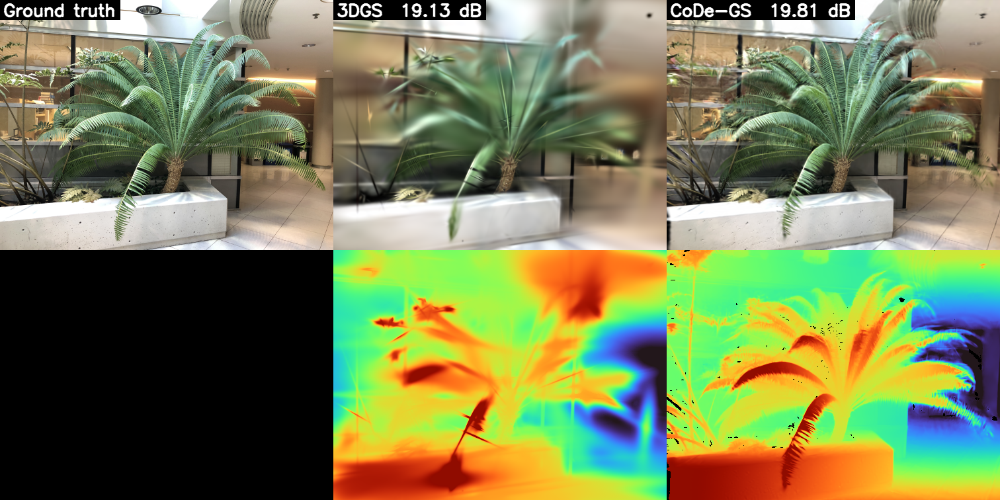

# CVproj · CoDe-GS

稀疏视角 3D Gaussian Splatting 课程项目：结合深度初始化、跨视角一致性加权深度先验与伪视角正则。

项目源码与完整使用说明位于 **[CoDeGS](CoDeGS/README.md)**。

- [训练入口](CoDeGS/train.py)：基线、改进方法与消融实验。
- [离线部署指南](CoDeGS/offline/README_OFFLINE.md)：依赖、模型与 LLFF 数据准备。
- [实验管理脚本](CoDeGS/scripts/run_managed.py)：短实验、30 组调参、112 组正式实验及展示素材生成。
- [环境验证记录](CoDeGS/training/environment_validation.json)与[数据验证记录](CoDeGS/training/data_validation.json)。

进入项目目录后，按完整说明准备环境与数据：

```bash
cd CoDeGS
bash scripts/run_smoke.sh
```

仓库保存源码、文档、验证记录和短实验对比图。依赖安装包、数据集、模型权重及训练输出由部署流程准备；本机部署信息记录在 `CoDeGS/training/deployment.json`。

## fern 短实验对比

1000 步训练后的一个测试视角，依次为真实图像、3DGS 和 CoDe-GS；下排为渲染深度。


